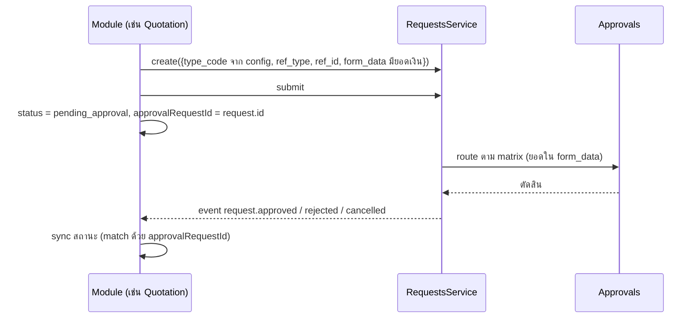
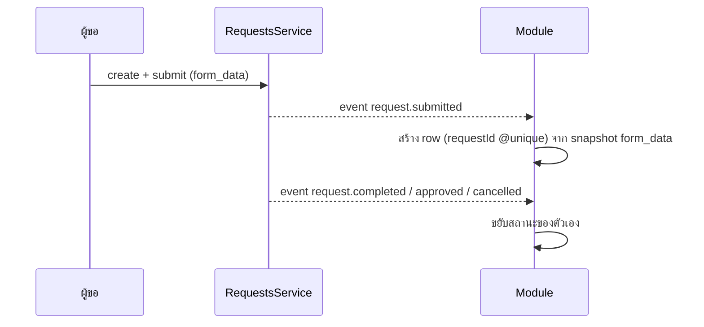
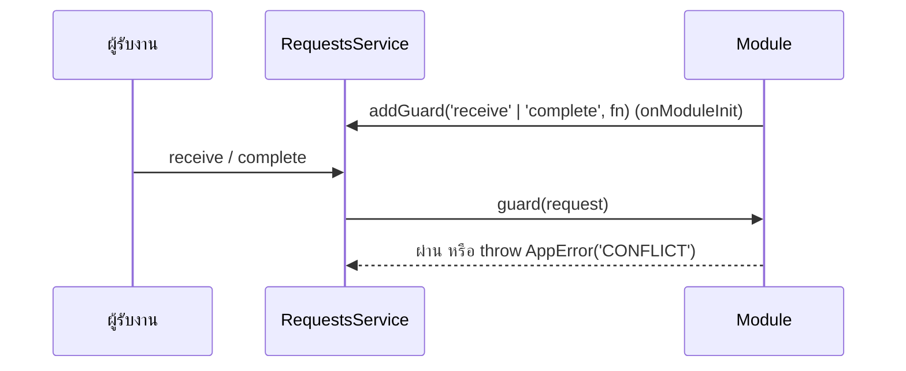

# Request ↔ module อื่น — การเชื่อมที่มีอยู่จริง

เอกสารนี้อธิบายว่า **module อื่นผูกกับ request อย่างไร** ไล่จากโค้ดที่รันอยู่ ทุก `path:line`
นับจาก `services/core-service/src/` เว้นแต่ระบุไว้ ใช้เป็นแบบเมื่อจะเพิ่ม module ที่ต้องอาศัย request
(เช่น module การเบิก — [`disbursement.md`](./disbursement.md))

**ตรวจครั้งล่าสุด 6 ต.ค. 2569** ด้วย `grep -rn "events.on(\|addGuard(\|ref_type:" services/core-service/src`

---

## 1. หลักที่ทุกรูปแบบใช้ร่วมกัน

1. **Request เป็นเจ้าของ lifecycle ของตัวเอง** — สถานะเปลี่ยนผ่าน `RequestsService` เท่านั้น
   (`requests/request-state-machine.ts` คือตารางที่ตัดสิน) module อื่นไม่เขียน `requests.status` ตรง ๆ
2. **Module รู้เรื่องที่เกิดกับ request ผ่าน domain event** — `events/domain-events.service.ts`
   เป็น bus ใน process, ส่ง *หลัง commit*, handler ที่ล้มถูก log แล้วกลืน (ไม่ย้อน request)
   ชื่อ event มีที่เดียวคือ `events/event-catalog.ts` (`DOMAIN_EVENTS`)
3. **Module ที่ต้อง *กั้น* request ใช้ guard** — `RequestsService.addGuard('receive' | 'complete', fn)`
   (`requests/requests.service.ts:137`) guard โยน `AppError` เพื่อหยุดการขยับ
4. **ตัวเชื่อมเป็น `requestId` แบบ string ธรรมดา** ไม่มี `@relation` ไม่มี `onDelete` (ดู §4) —
   request ไม่ถูกลบจริงอยู่แล้ว (soft delete) และ module ไม่ควรพังเพราะ FK ข้าม domain
5. **ประเภท request ที่ module ใช้มาจาก config ไม่ hardcode** — เช่น `CrmCompanyConfig.*TypeCode`
   (`libs/prisma/schema.prisma` ~2363–2534) เพิ่ม/เปลี่ยน type ได้จากหน้า admin
6. **Listener ต้อง idempotent** — event อาจมาซ้ำ (`event-catalog.ts` หัวไฟล์) ใช้ unique key
   (`requestId @unique`) หรือเช็คสถานะก่อนเขียน

## 2. สามรูปแบบ

### A. Module-first — module ยก request ไปขออนุมัติ

ข้อมูลหลักอยู่ใน module, request เป็นแค่ "ใบขออนุมัติ" ที่ module เปิดให้

| Module | ตัวเชื่อม | Listener |
|---|---|---|
| Quotation (ส่วนลด) | `Quotation.approvalRequestId` | `crm/quotation-approval-sync.service.ts:53` |
| ลูกค้าใหม่ | `Customer.approvalRequestId` | `crm/customer-approval.service.ts:93` |
| เป้าขาย | `SalesTargetRevision.approvalRequestId` | `crm/sales-target-approval-sync.service.ts:48` |
| Solution | `Solution.requestId` | `presales/solution-approval.service.ts:95` |
| PM change / design / resource / tech change / closeout | `requestId?` + `ref_type: 'project'` | `pm/change-requests.service.ts:101`, `pm/designs.service.ts:122`, `pm/resources.service.ts:124`, `pm/tech-changes.service.ts:103`, `pm/closeout.service.ts:124` |
| Installment invoice exception | `exceptionRequestId` | `delivery/installment-billing.service.ts:88` |

ข้อควรรู้: ถ้า type ไม่เปิดใช้ใน company module ต้องค้างที่ `draft` ไม่สร้างครึ่งทาง
(`docs/crm-flow.md` §2) และ PM อ่าน sync ซ้ำตอน list เผื่อ event หาย

### B. Request-first — module เก็บ snapshot เมื่อ request ถูกส่ง

ผู้ใช้ขอผ่าน request ตามปกติ, module ฟัง `request.submitted` แล้วสร้างข้อมูลของตัวเองผูกกับ `requestId`

| Module | ตัวเชื่อม | Listener |
|---|---|---|
| Contract request package | `ContractRequestPackage.requestId @id` | `crm/contract-request-package.service.ts:124` (submitted) |
| สัญญา | `CustomerContract.requestId?` | `crm/contracts.service.ts:72` (completed) |
| KYC | `CustomerKycRecord.requestId?` | `crm/kyc-callback.service.ts:77` (completed) |
| แบบสอบถามบริการ | `ServiceSurvey.requestId` | `support/surveys.service.ts:112` (completed) |
| **การเบิก (ใหม่)** | `Disbursement.requestId @unique` | ดู [`disbursement.md`](./disbursement.md) |

### C. Request เป็นตัวงาน — module กั้นด้วย guard

request คือใบงานที่คนทำจริง, module เก็บข้อมูลเสริมและ **ห้าม** request ขยับจนกว่าข้อมูลของตัวเองพร้อม

| Module | Guard | Event |
|---|---|---|
| Service work order | `support/work-orders.service.ts:108-109` (receive, complete) | `request.cancelled` คืน quota (`:112`) |
| **การเบิก (ใหม่)** | `advance` (ออกจากขั้นงานเงิน), `cancel`, `complete` (request ไม่มี flow) | `request.step.entered` — ดู [`disbursement.md`](./disbursement.md) |

`GuardedAction` = `receive | complete | cancel | advance` — การเบิกเพิ่ม `cancel` (ห้ามยกเลิกหลังเงินออก) และ `advance`
(guard ได้ขั้นที่กำลังออก/ไปถึง, ถอยกลับไม่ถูกกั้น)

### D. ticket + หน้าทำงาน (flow v2) — การเบิก

request เดินขั้นของตัวเอง (อนุมัติอยู่บน request ทั้งหมด) module เป็นหน้าทำงานของบางขั้น: action ของ module บันทึกข้อมูล
แล้วเรียก `RequestsService.advance` ให้ ticket ไปขั้นถัดไป, ฟัง `request.step.entered` เพื่อรู้ว่า ticket อยู่ขั้นไหน, และ
`addGuard('advance')` กันไม่ให้ใครเลื่อน ticket ข้ามขั้นที่งานของ module ยังไม่เสร็จ — รหัสขั้นเก็บใน config ของ module

การเบิก v3 ใช้ขั้นงานเดียว `DISBURSE`: `receive` ที่ `RECEIVE` เลื่อน ticket เข้า `DISBURSE` → `request.step.entered` สร้างใบเบิก;
`verify`/`pay` ไม่เลื่อน ticket; `close` ของการเบิกเลื่อนไป `DONE` — ลำดับเต็มและ guard ดู [`disbursement.md`](./disbursement.md) §2–4, §7

## 3. Event ที่ใช้ได้ (`events/event-catalog.ts`)

| Event | ความหมาย | ผู้ฟังตอนนี้ |
|---|---|---|
| `request.submitted` | ส่งครั้งแรก (มีเลข request แล้ว) | contract package, timeline |
| `request.returned` / `request.resubmitted` | ตีกลับ / ส่งใหม่ | timeline |
| `request.pre_approved` | ladder `:pre` อนุมัติครบ — ส่งต่อผู้รับ (งานยังไม่เสร็จ) | กลุ่ม A |
| `request.approved` | ผลยืนแล้ว (อนุมัติหลังงาน หรือ type ไม่มี matrix) | กลุ่ม A |
| `request.rejected` / `request.cancelled` | จบแบบไม่สำเร็จ | กลุ่ม A, work order |
| `request.completed` | ผู้รับแจ้งงานเสร็จ | contract, KYC, survey |
| `approval.step.pending` | มีงานรออนุมัติ | notifications |
| `approval.completed` / `approval.rejected` | ประกาศไว้ **แต่ยังไม่มีใคร emit** | — |
| `request.step.entered` | request flow v2 ยืนอยู่ที่ขั้น `step_code` (emit หลัง commit ใน `announceV2`) | การเบิก |
| `esign.completed` | เซ็นครบ | สัญญา, ใบรับมอบ |
| `sla.warning` / `sla.breached` | SLA | notifications |

payload ของ request event: `{company_id, request_id, request_no, type_code, requester_id, reason_codes?}`
`crm/request-timeline-sync.service.ts:62` ฟังทุก request event เพื่อลง timeline ของ CRM

**event ระดับ step มีตัวเดียวคือ `request.step.entered`** — การออกจากขั้นยังลงแค่ `RequestEvent` (`request.step.left`)

## 4. รูปแบบตัวเชื่อมใน schema

| รูปแบบ | ตัวอย่าง | ใช้เมื่อ |
|---|---|---|
| `requestId String` (+ `@unique` ถ้า 1:1) | `ServiceWorkOrder`, `ContractDraft`, `Solution`, `Disbursement` | module หนึ่ง row ต่อ request หนึ่งใบ |
| `approvalRequestId String?` | `Quotation`, `Customer`, `SalesTargetRevision` | รูปแบบ A — request เป็นใบขออนุมัติ |
| `refType/refId` บน request | `ref_type: 'project' \| 'opportunity' \| 'request'` | request ชี้กลับไปหา module (ฝั่ง request เก็บ) |
| `sourceType/sourceId` | `EsignEnvelope` | module ใช้ร่วมได้กับหลายเจ้าของ |
| `subjectType/subjectId` | `ApprovalCase` | อนุมัติสิ่งที่ไม่ใช่ request (เช่น `disbursement:ADVANCE`) |

## 5. Checklist เมื่อเพิ่ม module ที่ผูกกับ request

- [ ] เลือกรูปแบบ A / B / C ให้ชัด และเขียนลงเอกสารของ module
- [ ] type code อยู่ใน config ของ module ไม่ hardcode
- [ ] listener idempotent (unique key หรือเช็คสถานะ) และไม่ throw ออกไปทำให้ log เต็ม
- [ ] guard โยน `AppError` พร้อมข้อความภาษาไทยที่บอกว่าต้องทำอะไรก่อน
- [ ] เปลี่ยนสถานะ request ผ่าน `RequestsService` เท่านั้น
- [ ] module domain/http แยกกัน (`x.module.ts` / `x-http.module.ts`) ตาม `AGENTS.md`
