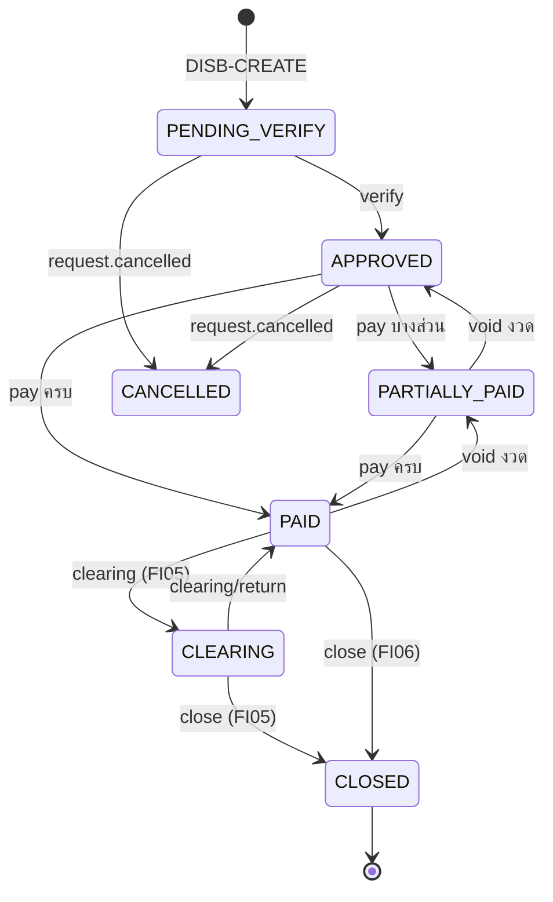
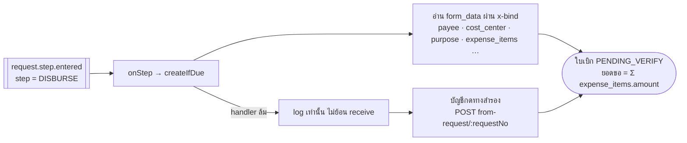
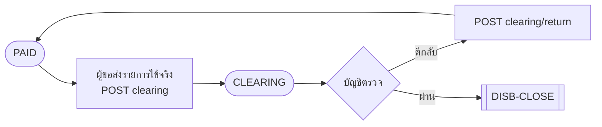
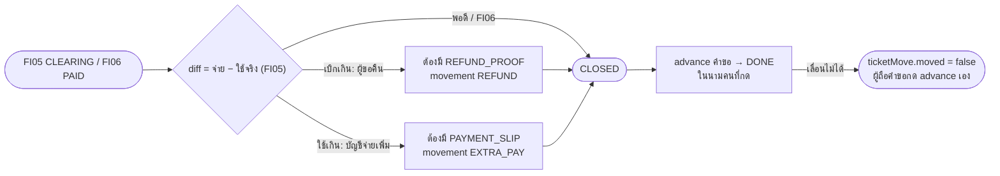

# Sub-flow ของใบเบิก (DISB-*)

ใช้กับ FI05 (เงินทดรองจ่าย, `ADVANCE`) และ FI06 (เงินสดย่อย, `PETTY_CASH`) ตาม flow v3
คำขอเป็นเจ้าของการขอและการอนุมัติทุกขั้น ส่วนงานเงิน (ตรวจ จ่าย เคลียร์ ปิด) ทำบนใบเบิก ซึ่งเกิดหลังอนุมัติครบ และผูกกับคำขอด้วย `requestId` (1 คำขอ : 1 ใบเบิก)
งานเงินจึงไม่ได้เป็นขั้นของคำขอ ระหว่างทำงานเงิน คำขอรออยู่ที่ขั้น `DISBURSE` (`in_progress`)

แหล่งที่มาหลัก (path นับจาก `request-management-backend/`)

| เรื่อง | ไฟล์ |
|---|---|
| กติกาครบทุกข้อ (สถานะ, เงิน, สิทธิ์, error) | [`docs/disbursement.md`](../../../request-management-backend/docs/disbursement.md) §3–8 |
| รอยต่อกับคำขอ | `services/core-service/src/disbursement/disbursement-request-sync.service.ts` (`onStep`, `createIfDue`, `addGuard`) |
| action | `services/core-service/src/disbursement/disbursements.service.ts` · กฎ `disbursement-rules.ts` |
| Open API | `services/external-service/src/disbursement/disbursement.controller.ts` (prefix `disbursement/disbursements`) |
| ภาพต้นทาง | `source/request type docs/expense/advance/1–7*.png`, `Flow_Advance.png` |

> ทุก route ของใบเบิกบน Open API ต้องผ่านสองด่าน: key ต้องมี `integration.disbursement.read` / `…manage` และคนที่ระบุใน `X-Acting-User` ต้องมีสิทธิ์เดียวกับที่หน้าเว็บใช้
> ถ้ามองไม่เห็นใบเบิก ระบบตอบ 404 ส่วน MCP มีแค่ tool อ่าน (`disbursement_get_disbursements`, `disbursement_get_disbursements_docno`) ยังไม่มี tool สำหรับเขียน

## สารบัญ

| ID | งาน | ใครทำ | FI05 | FI06 |
|---|---|---|---|---|
| [DISB-CREATE](#disb-create) | ระบบสร้างใบเบิกเมื่อคำขอเข้าขั้น `DISBURSE` | ระบบ | ✓ | ✓ |
| [DISB-VERIFY](#disb-verify) | บัญชีตรวจเอกสาร | บัญชี | ✓ | ✓ |
| [DISB-PAY](#disb-pay) | จ่ายเงิน (แบ่งเป็นงวดได้) และยกเลิกงวด | บัญชี | ✓ | ✓ |
| [DISB-CLEAR](#disb-clear) | ผู้ขอส่งเคลียร์ และบัญชีตีกลับ | ผู้ขอ / บัญชี | ✓ | — |
| [DISB-CLOSE](#disb-close) | ปิดใบเบิก คิดส่วนต่าง แล้วเลื่อนคำขอไป `DONE` | บัญชี | ✓ | ✓ |
| [DISB-CANCEL](#disb-cancel) | ใบเบิกเปลี่ยนตามคำขอ (ยกเลิก / ไม่อนุมัติ) | ระบบ | ✓ | ✓ |
| [DISB-FILE](#disb-file) | แนบหลักฐาน | ผู้ขอ / บัญชี | ✓ | ✓ |
| [DISB-VIEW](#disb-view) | ดูใบเบิก | ผู้ขอ / บัญชี | ✓ | ✓ |

### สถานะใบเบิก (v3)

---

## DISB-CREATE

**ระบบสร้างใบเบิกให้เอง** · ใครทำ: ระบบ · เริ่มเมื่อ: event `request.step.entered` ที่ขั้น `DISBURSE` (หลัง [REQ-RECEIVE](request.md#req-receive) ที่ขั้น `RECEIVE`)

| ขั้น | ใครทำ | API | เข้า | ออก | guard | สถานะหลังทำ |
|---|---|---|---|---|---|---|
| สร้างอัตโนมัติ | ระบบ | — (event listener) | `form_data` ที่ติด `x-bind: disbursement.<path>` | ใบเบิก + `sourceSnapshot` | ประเภทต้องผูกไว้ใน `disbursement_settings` (`advanceTypeCode` / `pettyCashTypeCode`) | `PENDING_VERIFY` |
| ทางสำรอง | บัญชี (`disbursement.pay`) | `POST disbursement/disbursements/from-request/:requestNo` | `requestNo` | ใบเบิก, `created` (มีอยู่แล้วได้ `false`) | คำขอยังไม่ถึง `DISBURSE` และไม่ได้อยู่ที่ `approved`/`closed` ได้ 409 | `PENDING_VERIFY` |

- อ่านค่าจากฟอร์มผ่าน `x-bind` เสมอ ไม่ใช้ชื่อ key ตายตัว ฟิลด์ที่ต้องติด tag ไว้อยู่ใน `requiredBindings()` (ทั้งสองแบบต้องมี `purpose`, `lines`, `lines.description`, `lines.amount` และ FI05 ต้องมี `clear_by` เพิ่ม)

## DISB-VERIFY

**บัญชีตรวจเอกสาร** · ใครทำ: ผู้รับหรือผู้ได้รับมอบหมายของคำขอ (`disbursement.verify`) ห้ามผู้ขอ · เริ่มเมื่อ: `PENDING_VERIFY` (ภาพ 4)

| ขั้น | API | เข้า | ออก | guard | สถานะหลังทำ |
|---|---|---|---|---|---|
| ตรวจ | `POST disbursement/disbursements/:docNo/verify` | `checked_cost_center`, `checked_documents`, `checked_authority`, `note` (ต้องครบทั้ง 4 ช่อง) | ใบเบิก, `ticketMove: null` | คำขอต้อง `in_progress` ที่ `DISBURSE` · 403 ผู้ขอหรือคนที่ไม่ได้ถือคำขอ · 400 ช่องขาด | `APPROVED` · คำขออยู่ที่ `DISBURSE` เหมือนเดิม |

## DISB-PAY

**จ่ายเงิน** · ใครทำ: บัญชี (`disbursement.pay`) ห้ามผู้ขอ · เริ่มเมื่อ: `APPROVED` หรือ `PARTIALLY_PAID` (ภาพ 5)

| action | API | เข้า | ออก | guard | สถานะหลังทำ |
|---|---|---|---|---|---|
| จ่าย | `POST …/:docNo/pay` | `amount`, `method` (`transfer` / `cash` / `cheque`), `paid_at?` (`YYYY-MM-DD`), `reference?` | ใบเบิก + movement `PAYOUT` | `amount` ต้องมากกว่า 0 และไม่เกินยอดที่เหลือ · 403 ผู้ขอ | ตามยอดสะสม `PARTIALLY_PAID` / `PAID` (FI06 ไม่ปิดเองเมื่อจ่ายครบ) |
| ยกเลิกงวด | `POST …/:docNo/payments/:movementId/void` | `reason` | movement `PAYOUT_VOID` | ต้องเป็นเจ้าหน้าที่**คนอื่น** ที่ไม่ใช่ผู้จ่ายงวดนั้น · ใช้กับ legacy ไม่ได้ · ยกเลิกซ้ำได้ 409 | ตามยอดที่เหลือ |

- `pay` ไม่ตรวจว่าผู้กดถือคำขออยู่หรือไม่ ซึ่งต่างจาก `verify` ([disbursement.md §8](../../../request-management-backend/docs/disbursement.md))
- แนบ `PAYMENT_SLIP` ได้ผ่าน [DISB-FILE](#disb-file)

## DISB-CLEAR

**เคลียร์ค่าใช้จ่าย (FI05 เท่านั้น)** · เริ่มเมื่อ: `PAID` (ภาพ 6)

| action | ใครทำ | API | เข้า | guard | สถานะหลังทำ |
|---|---|---|---|---|---|
| ส่งเคลียร์ | **ผู้ขอเท่านั้น** (`request.create`) | `POST …/:docNo/clearing` | `items[]: {description, amount, cost_center?, note?, receipt_date?}` (ส่งซ้ำจะแทนที่ ACTUAL เดิม) | 403 ไม่ใช่ผู้ขอ · 409 เป็นเงินสดย่อย / สถานะไม่ใช่ `PAID` | `CLEARING` |
| ตีกลับ | บัญชี (`disbursement.verify`) | `POST …/:docNo/clearing/return` | `reason` | 409 สถานะ | `PAID` |

- แนบ `RECEIPT` ผ่าน [DISB-FILE](#disb-file)
- `PROPOSED`: AI อ่านใบเสร็จ (OCR) แล้วเติม `items` ให้ · แจ้งเตือนเมื่อใกล้หรือเลย `clear_by` (ยังไม่มี scheduler)

## DISB-CLOSE

**ปิดใบเบิก** · ใครทำ: บัญชี (`disbursement.pay`) ห้ามผู้ขอ · เริ่มเมื่อ: FI05 `CLEARING` / FI06 `PAID` (ภาพ 7)

| ขั้น | API | เข้า | ออก | guard | สถานะหลังทำ |
|---|---|---|---|---|---|
| ปิด | `POST …/:docNo/close` | `method?`, `reference?`, `occurred_at?` (`YYYY-MM-DD`), `counterparty_user_id?` | ใบเบิก + `ticketMove` | มีส่วนต่างแต่ไม่ส่ง `method` ได้ 400 · ไม่มีสลิปที่แนบหลังส่งเคลียร์ครั้งล่าสุดได้ 400 (`field: files`) · 403 ผู้ขอ | ใบเบิก `CLOSED` · คำขอเลื่อนไปขั้น `DONE` (`approved`) |

- guard ที่ใบเบิกติดไว้บนคำขอ: เลื่อนไปข้างหน้าจากขั้น `DISBURSE` ได้เมื่อใบเบิกเป็น `CLOSED` แล้วเท่านั้น (`addGuard`)
- หลังจากนี้ ผู้ขอปิดคำขอเองที่ขั้น `DONE` ด้วย [REQ-CLOSE](request.md#req-close) (`advance END`)

## DISB-CANCEL

**ใบเบิกเปลี่ยนตามคำขอ** · ใครทำ: ระบบ · เริ่มเมื่อ: event ของคำขอ

| event ของคำขอ | ผลต่อใบเบิก |
|---|---|
| `request.cancelled` | `CANCELLED` (ถ้าสถานะปัจจุบันย้ายได้) |
| `request.rejected` | `REJECTED` |
| `request.returned` | `RETURNED` |

- กติกาฝั่งคำขอ: เงินออกแล้ว (`PARTIALLY_PAID` / `PAID` / `CLEARING` / `CLOSED`) [REQ-CANCEL](request.md#req-cancel) ได้ 409 `CONFLICT`
- ตามลำดับขั้นของ v3 คำขอจะถูกไม่อนุมัติหรือถูกส่งกลับก่อนมีใบเบิกเสมอ สองแถวหลังจึงมีผลกับคำขอบน flow legacy เป็นหลัก

## DISB-FILE

| ชนิด | ใครแนบ | ใช้ตอน |
|---|---|---|
| `PAYMENT_SLIP` | บัญชี (`disbursement.pay`) | จ่ายแต่ละงวด และจ่ายส่วนต่างเมื่อใช้เกิน |
| `RECEIPT` | ผู้ขอ / บัญชี | เคลียร์ (FI05) |
| `REFUND_PROOF` | ผู้ขอ / บัญชี | ผู้ขอคืนเงินส่วนที่เบิกเกิน |
| `OTHER` | ผู้ขอ / บัญชี | — |

- PDF / JPG / PNG ไม่เกิน 10 MB · route `POST/GET/DELETE disbursements/:docNo/files[/:fileId]` อยู่ที่ **core เท่านั้น**
- `PROPOSED`: แนบไฟล์ผ่าน Open API / แชท

## DISB-VIEW

| ขั้น | API / MCP | ออก | ใครเห็น |
|---|---|---|---|
| รายการ | `GET disbursement/disbursements` · `disbursement_get_disbursements` | ใบเบิก | ผู้ขอเห็นของตัวเอง · คนที่มี `disbursement.read.any` / `disbursement.pay` เห็นทั้งบริษัท |
| ทีละใบ | `GET …/:docNo` · `disbursement_get_disbursements_docno` | `legacy`, `movements`, `files`, `ticket {status, stepCode, assigneeUserId}` | เหมือนกัน |
| จากคำขอ | `GET …/by-request/:requestNo` | ใบเบิกของคำขอนั้น | เหมือนกัน |
