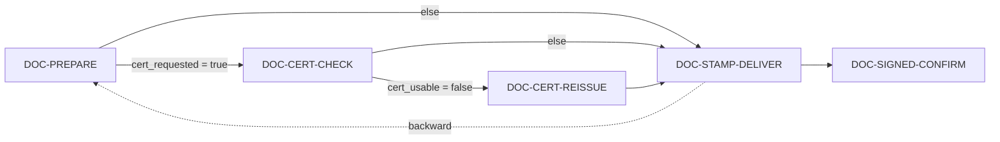

# Sub-flow ของการขอใช้เอกสาร (DOC-*)

ใช้กับ SOP_DOCREQ (การขอใช้เอกสารสำคัญของบริษัท ภายในองค์กร)
แต่ละ sub-flow ตรงกับหนึ่งขั้นของ flow v2 ที่ผู้ดูแลเอกสารเป็นคนทำ
ทุกขั้นบันทึกงานผ่าน [REQ-STEP-FORM](request.md#req-step-form) แล้วไปขั้นถัดไปด้วย [REQ-ADVANCE](request.md#req-advance)
ส่วนทางแยกใช้ค่าจากฟอร์มของขั้นนั้นเป็นเงื่อนไข

แหล่งที่มาหลัก

| เรื่อง | ไฟล์ |
|---|---|
| ขั้น ฟอร์ม และทางแยก | `request-management-backend/libs/prisma/sop-docreq-flow.ts` (`SOP_DOCREQ_FLOW`, `PREPARE_FORM`, `CERT_CHECK_FORM`, `CERT_REISSUE_FORM`, `STAMP_DELIVER_FORM`) |
| ตั้งค่าประเภท | `request-management-backend/libs/prisma/seed-sop-docreq-type.ts` (แผนกที่ขอได้ `FAC`, `LEG`, `PCD` · SLA 24 ชม. แบบ `H8X5` · ผู้รับตาม `RECEIVER_EMAIL` · เหตุผลส่งกลับ 4 รหัส) |
| SOP ต้นทาง | `source/request type docs/SOP-BSD-DOCREQ/SOP-BSD-DOCREQ.docx` ข้อ 1–6 |

> **สิ่งที่ยังทำผ่านแชทไม่ได้**
> ทุกขั้นในไฟล์นี้ต้องบันทึก step form และ `SIGNED_DOCUMENT` ต้องแนบไฟล์ ซึ่งตอนนี้ทำได้เฉพาะบนหน้าเว็บ (core)
> แชทจึงช่วยได้แค่ยื่นคำขอ อนุมัติ รับเรื่อง และดูสถานะ ส่วน AGENT 1 / AGENT 2 ตาม SOP ยังเป็น `PROPOSED` ทั้งหมด

## สารบัญ

| ID | ขั้นของ flow | งาน | ใครทำ | SOP |
|---|---|---|---|---|
| [DOC-PREPARE](#doc-prepare) | `PREPARE` | ค้นไฟล์ฉบับล่าสุด | ผู้ดูแลเอกสาร (+ AGENT 1 `PROPOSED`) | ข้อ 4–5 |
| [DOC-CERT-CHECK](#doc-cert-check) | `CERT_CHECK` | ตรวจวันที่ของหนังสือรับรอง | ผู้ดูแลเอกสาร (+ AGENT 2 `PROPOSED`) | ข้อ 5.2 |
| [DOC-CERT-REISSUE](#doc-cert-reissue) | `CERT_REISSUE` | คัดหนังสือรับรองใหม่ | ผู้ดูแลเอกสาร | ข้อ 5.2, 1–2 |
| [DOC-STAMP-DELIVER](#doc-stamp-deliver) | `STAMP_DELIVER` | คาดข้อความ พิมพ์ และส่งเอกสาร | ผู้ดูแลเอกสาร (+ AGENT 1 `PROPOSED`) | ข้อ 5.1 |
| [DOC-SIGNED-CONFIRM](#doc-signed-confirm) | `SIGNED_CONFIRM` | แนบเอกสารที่ลงนามแล้ว และปิดงาน | ผู้ขอ | ข้อ 6 |
| [DOC-REGISTER](#doc-register) | — (นอก flow) | นำเอกสารบริษัทเข้า Folder และลงทะเบียน | ผู้ดูแลเอกสาร | ข้อ 1–2 |

---

## DOC-PREPARE

**ค้นไฟล์ฉบับล่าสุด** · ใครทำ: ผู้ดูแลเอกสาร (ผู้ถือขั้น) · เริ่มเมื่อ: [REQ-RECEIVE](request.md#req-receive) ที่ขั้น `RECEIVE` เลื่อนคำขอมาที่ `PREPARE` (`in_progress`)

| ขั้น | ใครทำ | API | เข้า (step form) | guard | ไปขั้นถัดไป |
|---|---|---|---|---|---|
| 1 ค้นไฟล์ | AI · `PROPOSED` (AGENT 1) | — | `documents[]` ในฟอร์มคำขอ, ชื่อบริษัท | เปิดเฉพาะไฟล์ที่อัปเดตล่าสุดใน Folder ของบริษัท | — |
| 2 บันทึก | ผู้ดูแลเอกสาร | core `PATCH requests/:id/step-form` | `files_located` ✓, `cert_requested` ✓, `note?` | ต้องกรอกครบทั้ง 2 ช่องที่บังคับ | — |
| 3 เลื่อน | ผู้ดูแลเอกสาร | `advance` | `to_step` | ทางแยกตาม `cert_requested` | `CERT_CHECK` เมื่อ `cert_requested = true` ไม่อย่างนั้นไป `STAMP_DELIVER` |

- `cert_requested` ซ้ำกับ `includes_company_cert` ในฟอร์มคำขอ เพราะเงื่อนไขของ flow อ่านค่าใน `documents[]` ไม่ได้ และผู้ดูแลต้องยืนยันค่านี้อีกครั้งในขั้นนี้
- `PROPOSED`: Folder เอกสารบริษัทที่ AI เข้าถึงได้ และสิทธิ์ของ AI ในการเปิดไฟล์

## DOC-CERT-CHECK

**ตรวจวันที่ของหนังสือรับรอง** · เริ่มเมื่อ: `cert_requested = true`

| ขั้น | ใครทำ | API | เข้า (step form) | กติกา (SOP 5.2) | ไปขั้นถัดไป |
|---|---|---|---|---|---|
| 1 ตรวจ | AI · `PROPOSED` (AGENT 2) | — | วันที่ของไฟล์ล่าสุด, `cert_valid_days`, `needed_by` | วันที่เอกสาร + `cert_valid_days` ต้องไม่เกิน `needed_by` · `cert_valid_days` ไม่เกิน 30 วัน (+ grace period 5 วัน) | — |
| 2 บันทึก | ผู้ดูแลเอกสาร | core `PATCH requests/:id/step-form` | `cert_document_date`, `cert_usable`, `note?` | — | — |
| 3 เลื่อน | ผู้ดูแลเอกสาร | `advance` | — | — | `CERT_REISSUE` เมื่อ `cert_usable = false` ไม่อย่างนั้นไป `STAMP_DELIVER` |

## DOC-CERT-REISSUE

**คัดหนังสือรับรองใหม่** · เริ่มเมื่อ: `cert_usable = false` · SLA ของขั้น 8 ชม. (`sla_hours: 8`)

| ขั้น | ใครทำ | API | เข้า (step form) | ไปขั้นถัดไป |
|---|---|---|---|---|
| 1 คัดเอกสาร | ผู้ดูแลเอกสาร | — | — | — |
| 2 แจ้งผู้ขอว่าต้องรอ 1 วันทำการ | ผู้ดูแลเอกสาร | [REQ-COMMENT](request.md#req-comment) | ข้อความ | — |
| 3 นำเข้า Folder และลงทะเบียน | ผู้ดูแลเอกสาร | [DOC-REGISTER](#doc-register) | — | — |
| 4 บันทึก | ผู้ดูแลเอกสาร | core `PATCH requests/:id/step-form` | `new_cert_date`, `uploaded_to_folder` ✓ | — |
| 5 เลื่อน | ผู้ดูแลเอกสาร | `advance` | — | `STAMP_DELIVER` |

- flow ไม่มีทางย้อนกลับไป `CERT_CHECK` เพราะระบบไม่ยอมให้วนรอบไปข้างหน้า วันที่ของฉบับใหม่จึงบันทึกไว้ในขั้นนี้แทนการตรวจซ้ำ ([`sop-docreq-flow.ts`](../../../request-management-backend/libs/prisma/sop-docreq-flow.ts) comment ที่ transition `CERT_REISSUE`)
- `PROPOSED`: แจ้งผู้ขอให้รอ 1 วันทำการโดยอัตโนมัติ

## DOC-STAMP-DELIVER

**คาดข้อความ พิมพ์ และส่งเอกสาร** · เริ่มเมื่อ: มาจาก `PREPARE`, `CERT_CHECK` หรือ `CERT_REISSUE`

| ขั้น | ใครทำ | API | เข้า (step form) | ไปขั้นถัดไป |
|---|---|---|---|---|
| 1 คาดข้อความ | AI · `PROPOSED` (AGENT 1) | — | `watermark_text` จากฟอร์มคำขอ | — |
| 2 ตรวจ บันทึกไฟล์ และพิมพ์ | ผู้ดูแลเอกสาร | — | — | — |
| 3 บันทึก | ผู้ดูแลเอกสาร | core `PATCH requests/:id/step-form` | `delivered_on`, `copies_delivered`, `note?` | — |
| 4 เลื่อน | ผู้ดูแลเอกสาร | `advance` | — | `SIGNED_CONFIRM` · หรือถอยกลับไป `PREPARE` (`backward`) |

## DOC-SIGNED-CONFIRM

**แนบเอกสารที่ลงนามแล้ว และปิดงาน** · ใครทำ: ผู้ขอ (ขั้น scope `approved` ผู้ขอเป็นผู้ถือขั้น)

| ขั้น | ใครทำ | API | เข้า | guard | สถานะหลังทำ |
|---|---|---|---|---|---|
| 1 แนบไฟล์ | ผู้ขอ | [REQ-ATTACH](request.md#req-attach) core `POST requests/:id/attachments` | ไฟล์ชนิด `SIGNED_DOCUMENT` | `required_docs` ของขั้นบังคับให้มีไฟล์นี้ | `approved` |
| 2 ปิดงาน | ผู้ขอ | [REQ-CLOSE](request.md#req-close) `advance {to_step: "END"}` | — | — | `closed` |

## DOC-REGISTER

**นำเอกสารบริษัทเข้า Folder และลงทะเบียน (SOP ข้อ 1–2)** · ใครทำ: ผู้ดูแลเอกสาร · อยู่นอก flow ของคำขอ

- ระบบมีแค่รายชื่อเอกสาร 8 รายการ (`SOP_DOCUMENTS`) ที่ใช้เป็นตัวเลือกในฟอร์ม
- `PROPOSED`: ทะเบียนเอกสาร (วันที่รับเข้า วันที่เอกสาร ชื่อบริษัท ชื่อเอกสาร ประเภทที่มี/ไม่มีอายุ ระดับความอ่อนไหว) และที่เก็บ Folder · ตอนนี้ขั้น `CERT_REISSUE` เก็บไว้แค่ช่องติ๊ก `uploaded_to_folder`
