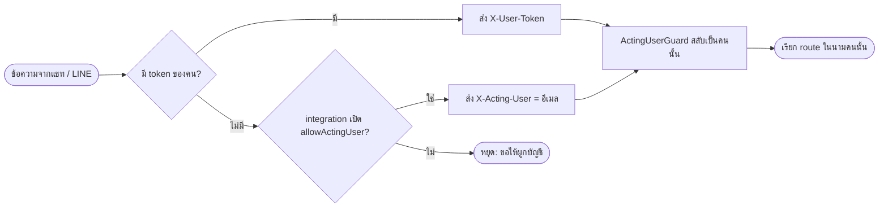
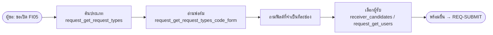
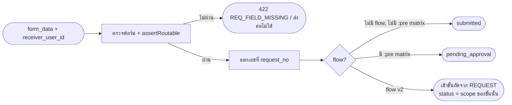
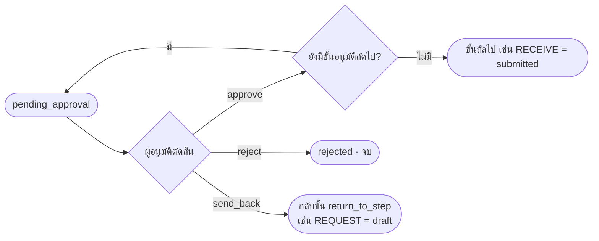
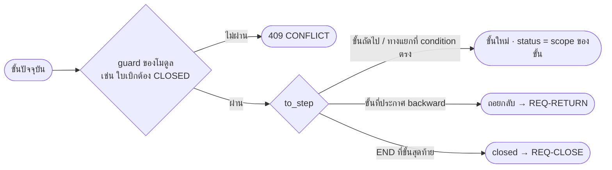
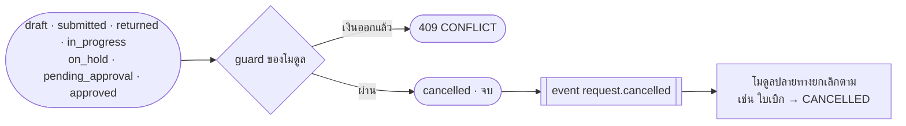
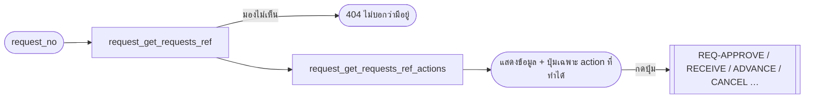
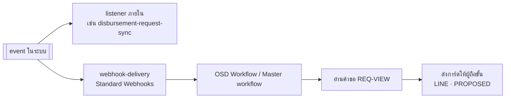

# Sub-flow ของคำขอ (REQ-*)

sub-flow ในไฟล์นี้ใช้ได้กับคำขอทุกประเภท ไฟล์ประเภทคำขอใน [`../types/`](../types/) หยิบไปเรียงต่อกันเป็นวงจรเต็ม
วิธีอ่านผัง ป้าย และคอลัมน์ของตาราง อยู่ที่ [`../README.md`](../README.md#วิธีอ่าน)

แหล่งที่มาหลัก (path นับจาก `request-management-backend/`)

| เรื่อง | ไฟล์ |
|---|---|
| สถานะและการเปลี่ยนสถานะ | `services/core-service/src/requests/request-state-machine.ts` (`REQUEST_TRANSITIONS`) |
| action, ผู้มีสิทธิ์, ฟิลด์ที่ต้องส่ง | `services/core-service/src/requests/available-actions.ts` (`ACTIONS`, `hasAuthority`, `REPLACED_BY_FLOW_V2`) |
| route ของหน้าเว็บ (core) | `services/core-service/src/requests/requests.controller.ts` |
| route ของ Open API (external) | `services/external-service/src/request/request.controller.ts` (prefix `request/`) |
| MCP tool | `docs/openapi/external-tools.json` |
| event | `services/core-service/src/events/event-catalog.ts` · ส่งออกผ่าน `webhook/webhook-delivery.service.ts` |
| บทสนทนาในแชท | [`docs/system-overview/04-chat-workflow.md`](../../system-overview/04-chat-workflow.md) (C-01…C-23) |

> **flow v2 เปลี่ยนชุด action**
> ประเภทคำขอที่ publish flow `schema_version: 2` (FI05, FI06 และ SOP_DOCREQ ใช้แบบนี้ทั้งหมด) ไม่มี action `complete`, `close`, `resubmit` และ `return` (`REPLACED_BY_FLOW_V2`)
> สามงานนี้ใช้ `advance` แทน: ทำงานเสร็จ, ส่งกลับ (ถอยไปขั้นที่ประกาศ `backward: true`) และปิดงาน (`to_step: "END"`)
> สถานะของคำขอคือ `scope_status` ของขั้นที่คำขออยู่ ตารางในแต่ละ sub-flow แยกคอลัมน์ "ไม่มี flow / v1" กับ "flow v2" เมื่อสองแบบทำงานต่างกัน

## สารบัญ

| ID | งาน | ใครทำ | action / route หลัก |
|---|---|---|---|
| [REQ-IDENTIFY](#req-identify) | ระบุตัวคนที่ระบบภายนอกทำงานแทน | workflow / ระบบ | `X-User-Token` · `X-Acting-User` |
| [REQ-CREATE](#req-create) | เลือกประเภท อ่านฟอร์ม แล้วกรอก | ผู้ขอ | `request-types`, `request-types/:code/form` |
| [REQ-SUBMIT](#req-submit) | ยื่นคำขอ ออกเลขที่ เข้าขั้นแรก | ผู้ขอ | `submit` · `POST request/requests` |
| [REQ-APPROVE](#req-approve) | อนุมัติ ไม่อนุมัติ หรือส่งกลับ ที่ขั้นอนุมัติ | ผู้อนุมัติ | `approve` · `reject` · `send_back` |
| [REQ-RECEIVE](#req-receive) | ผู้รับรับเรื่อง แล้ว SLA เริ่มนับ | ผู้รับที่ระบุชื่อ | `receive` |
| [REQ-ASSIGN](#req-assign) | ส่งต่องานให้อีกคน | ผู้ถือขั้น | `assign` |
| [REQ-STEP-FORM](#req-step-form) | บันทึกฟอร์มของขั้น | ผู้ถือขั้น | `PATCH requests/:id/step-form` (core) |
| [REQ-ADVANCE](#req-advance) | เลื่อนไปขั้นถัดไป เลือกทางแยก หรือปิดงาน | ผู้ถือขั้น | `advance {to_step}` |
| [REQ-RETURN](#req-return) | ส่งกลับให้ผู้ขอแก้ แล้วยื่นใหม่ | ผู้รับ / หัวหน้า → ผู้ขอ | v1 `return` + `resubmit` · v2 `advance` ถอยกลับ |
| [REQ-HOLD](#req-hold) | พักงาน แล้วทำต่อ | ผู้ถืองาน | `hold` · `resume` |
| [REQ-CANCEL](#req-cancel) | ยกเลิกคำขอ | ผู้ขอ / หัวหน้า | `cancel {reason}` |
| [REQ-CLOSE](#req-close) | ผู้ขอรับผลและปิดคำขอ | ผู้ขอ | v1 `close` · v2 `advance END` |
| [REQ-VIEW](#req-view) | เปิดดูคำขอและ action ที่ทำได้ | ทุกคนที่มองเห็นคำขอ | `GET requests/:ref` · `GET requests/:ref/actions` |
| [REQ-SEARCH](#req-search) | ดูคิวงาน ค้นหา และนับจำนวน | ทุกคน | `GET requests` · `GET requests/summary` |
| [REQ-COMMENT](#req-comment) | เขียนคอมเมนต์ | ทุกคนที่มองเห็นคำขอ | `comment {body}` |
| [REQ-ATTACH](#req-attach) | แนบไฟล์ | ผู้ขอ / ผู้ถือขั้น | `POST requests/:id/attachments` (core) |
| [REQ-CHILD](#req-child) | เปิดคำขอลูก และดูสายคำขอ | ทุกคนที่มองเห็นคำขอ | `create_child` · `GET requests/:ref/tree` |
| [REQ-NOTIFY](#req-notify) | แจ้งคนถัดไป เมื่อสถานะหรือขั้นเปลี่ยน | ระบบ → workflow | event → webhook · LINE `PROPOSED` |

---

## REQ-IDENTIFY

**ระบุตัวคนที่ระบบภายนอกทำงานแทน** · ใครทำ: workflow (แชท / LINE) · เริ่มเมื่อ: ทุกครั้งก่อนเรียก Open API หรือ MCP ที่มีคนเป็นเจ้าของงาน

| ขั้น | ใครทำ | API / MCP | เข้า | ออก | guard | สถานะหลังทำ |
|---|---|---|---|---|---|---|
| 1 จับคู่ผู้ใช้ | workflow | — | LINE user id / login ของแชท | อีเมลใน `users.email` | ต้องตรงตัวพิมพ์ ไม่ใช้ username แทน | — |
| 2 แนบตัวตน | workflow | header ของทุก request | `X-User-Token` หรือ `X-Acting-User` | — | ส่งพร้อมกันทั้งสอง header ได้ 400 · คนอยู่นอกบริษัทของ key ได้ 404 | — |
| 3 ตรวจสิทธิ์ซ้ำ | ระบบ | `ActingPolicyGuard` + `assertMayAct` | — | คนที่ใช้ตัดสินสิทธิ์ | ตรวจกับสิทธิ์ของคน ไม่ใช้สิทธิ์ของ key | — |

- LibreChat บน MCP ส่ง bearer ของคนนั้นมาเอง จึงไม่ต้องส่ง header ทั้งสองตัว
- ที่มา: `services/external-service/src/auth/resolve-caller.ts` · `auth/acting-user.guard.ts` · `request-management-backend/AGENTS.md` หัวข้อ "two gates"
- `PROPOSED`: การผูก LINE user กับอีเมล (ยังไม่มีตารางเก็บคู่นี้)

## REQ-CREATE

**เลือกประเภทแล้วกรอกฟอร์ม** · ใครทำ: ผู้ขอ · เริ่มเมื่อ: ผู้ขอบอกว่าจะเปิดคำขอ (แชท C-02, C-03)

| ขั้น | ใครทำ | API / MCP | เข้า | ออก | guard | สถานะหลังทำ |
|---|---|---|---|---|---|---|
| 1 ค้นประเภท | ผู้ขอ / AI | `GET request/request-types?q=` · `request_get_request_types` | คำค้น | `code`, ชื่อ, แผนกที่ขอได้ | เห็นเฉพาะประเภทที่แผนกของตนขอได้ | — |
| 2 อ่านฟอร์ม | AI | `GET request/request-types/:code/form` · `request_get_request_types_code_form` | `code` | JSON Schema (`required`, `enum`, `x-order`) · `receiver_candidates` | — | — |
| 3 กรอก | ผู้ขอ | — (ในแชท / หน้าเว็บ) | ค่าตาม schema | `form_data` | ช่อง `x-options-source` ต้องใช้ค่าจาก master เช่น `cost_centers` | — |
| 3′ เก็บร่าง (เว็บ) | ผู้ขอ | `POST requests` · `PATCH requests/:id` (core) | `form_data` | คำขอ `draft` ที่ยังไม่มีเลขที่ | แก้ได้เฉพาะ `draft` / `returned` (`EDITABLE_STATUSES`) | `draft` |

- Open API ไม่มีขั้นเก็บร่าง เพราะสร้างกับยื่นอยู่ใน call เดียว (REQ-SUBMIT)
- ฟอร์มของ flow v2 คือ `form_schema` ของขั้น `REQUEST` แต่ `GET request-types/:code/form` อ่านฟอร์มของ type ไม่ใช่ของขั้น จึงไม่ส่งตัวเลือก `cost_centers` มาด้วย ([disbursement.md §8](../../../request-management-backend/docs/disbursement.md))

## REQ-SUBMIT

**ยื่นคำขอ** · ใครทำ: ผู้ขอ · เริ่มเมื่อ: ฟอร์มครบและเลือกผู้รับแล้ว (แชท C-04)

| ขั้น | ใครทำ | API / MCP | เข้า | ออก | guard | สถานะหลังทำ |
|---|---|---|---|---|---|---|
| ยื่น (Open API) | ผู้ขอ | `POST request/requests` · `request_post_requests` (สร้างและยื่นใน call เดียว: `createAndSubmit`) | `type_code`, `form_data`, `receiver_user_id`, `ref_type`/`ref_id`? | `request_no`, `status`, `stepCode` | 400/422 `REQ_FIELD_MISSING` · 404 ไม่พบผู้รับ · 400 ผู้รับไม่อยู่ใน `receiver_candidates` | ตามผัง |
| ยื่น (เว็บ) | ผู้ขอ | `POST requests/:id/submit` (core) | `form_data`, `receiver_user_id` | เหมือนด้านบน | ผู้ขอเท่านั้น (`requester`) | ตามผัง |

ผลข้างเคียง
- ออกเลขที่เมื่อเข้า `submitted` (`NUMBER_ISSUED_ON`) หรือเมื่อออกจากขั้นร่างใน flow v2
- นาฬิกา SLA ยังไม่เดิน ทั้งตอน `submitted` และ `pending_approval` ก่อนมีคนรับเรื่อง จะเริ่มนับเมื่อรับเรื่องครั้งแรก (`CLOCK_PAUSED_IN`, PO D1 2026-09-25)
- event: `request.submitted` · flow v2 ส่ง `request.step.entered` ด้วย

ข้อจำกัดที่รู้: ถ้า Open API ตอบ 422 จะเหลือคำขอ `draft` ที่ไม่มีเลขที่ค้างไว้ และคำตอบไม่บอก id ([disbursement.md §8](../../../request-management-backend/docs/disbursement.md))

## REQ-APPROVE

**ตัดสินที่ขั้นอนุมัติ** · ใครทำ: ผู้อนุมัติของชั้นปัจจุบัน (`decider`) · เริ่มเมื่อ: คำขอ `pending_approval` (แชท C-07, C-17)

| action | ใครทำ | API / MCP | เข้า | ออก | guard | สถานะหลังทำ |
|---|---|---|---|---|---|---|
| `approve` | คนใน `candidateUserIds` ของชั้นปัจจุบัน | `POST request/requests/:ref/actions/approve` · `request_post_requests_ref_actions_action` | `note` (บังคับ) | เคสอนุมัติ (`CaseWithSteps`) ไม่ใช่ตัวคำขอ | `APV_NOT_YOUR_TURN` · `REQ_STATE_INVALID` · ห้ามอนุมัติคำขอของตัวเอง (`approval-chain.ts`) | v2: ขั้นอนุมัติถัดไป หรือขั้นที่ตามมา · ไม่มี flow: `submitted` (ก่อนทำงาน) / `approved` (หลังทำงาน) |
| `reject` | เหมือนกัน | เหมือนกัน | `note` | เคสอนุมัติ | เหมือนกัน | `rejected` (จบ) |
| `send_back` | เหมือนกัน | เหมือนกัน | `note` | เคสอนุมัติ | เหมือนกัน | v2: `return_to_step` ของขั้น · ก่อนทำงาน: `returned` · หลังทำงาน: `in_progress` |

- flow v2 ประกาศผู้อนุมัติไว้บนขั้นเอง (`approval_levels`: `supervisor up:1` = หัวหน้าตามสาย, `org` = คนในหน่วย) ไม่ใช้ approval matrix
- อ่านสถานะคำขอหลังตัดสินด้วย `GET request/requests/:ref` เพราะ action นี้ตอบกลับเป็นเคสอนุมัติ
- ระบบหาผู้รับมอบอำนาจ (delegation) ตอนตัดสิน ไม่ใช่ตอนยื่น ประวัติจึงเก็บทั้ง `approverUserId` และ `decidedByUserId`
- event: `request.approved` · `request.pre_approved` · `request.rejected` · `request.step.entered`
- `PROPOSED`: การ์ดอนุมัติทาง LINE ที่มีปุ่มกด (ตอนนี้ตัดสินได้จากกล่องอนุมัติบนเว็บ หรือจากแชทผ่าน MCP)

## REQ-RECEIVE

**ผู้รับรับเรื่อง** · ใครทำ: ผู้รับที่ระบุชื่อ (`receiver`) เท่านั้น ส่งต่อให้คนอื่นรับแทนไม่ได้ · เริ่มเมื่อ: `submitted` (แชท C-08, C-11)

| ขั้น | ใครทำ | API / MCP | เข้า | ออก | guard | สถานะหลังทำ |
|---|---|---|---|---|---|---|
| รับเรื่อง | `receiverUserId` | `actions/receive` · core `POST requests/:id/receive` | — | คำขอ | ไม่ใช่ผู้รับได้ 403 (scope grant ก็ใช้แทนไม่ได้) · `REQ_STATE_INVALID` | `in_progress` · v2 เลื่อนไปขั้นถัดจาก `RECEIVE` เอง |

- นาฬิกา SLA เริ่มเดินครั้งแรกที่นี่ flow v2 นับต่อทุกขั้นหลังจากนี้ รวมขั้นอนุมัติด้วย (D7)
- flow v2 ที่ขั้น scope `submitted` ใช้ `advance` ไปข้างหน้าไม่ได้ (`REQ_STEP_INVALID`) ต้องใช้ `receive` เท่านั้น
- event: `request.step.entered` (ใบเบิกของ FI05/FI06 สร้างจาก event นี้ ดู [DISB-CREATE](disbursement.md#disb-create))

## REQ-ASSIGN

**ส่งต่องานให้อีกคน** · ใครทำ: ผู้ถือขั้น (`step_holder`) · เริ่มเมื่อ: สถานะใดก็ได้ที่ยังไม่จบ (แชท C-12)

| ขั้น | ใครทำ | API / MCP | เข้า | ออก | guard | สถานะหลังทำ |
|---|---|---|---|---|---|---|
| มอบหมาย | ผู้ถือขั้น หรือ scope grant ที่มี `request.complete` | `actions/assign` · core `POST requests/:id/assign` | `assignee_user_id` | คำขอ (`assigneeUserId`) | flow v2 ไม่มี `assign` ที่ขั้นอนุมัติ (ใช้ delegation แทน) | ไม่เปลี่ยน |

## REQ-STEP-FORM

**บันทึกฟอร์มของขั้น** · ใครทำ: ผู้ถือขั้น · เริ่มเมื่อ: ขั้นปัจจุบันมี `form_schema` เช่น `PREPARE` และ `CERT_CHECK` ของ SOP_DOCREQ

| ขั้น | ใครทำ | API / MCP | เข้า | ออก | guard | สถานะหลังทำ |
|---|---|---|---|---|---|---|
| บันทึก | ผู้ถือขั้น | core `PATCH requests/:id/step-form` | ค่าตาม `form_schema` ของขั้น | คำขอ | ช่องที่ `required` ต้องครบก่อน `advance` · ค่าในฟอร์มใช้เป็นเงื่อนไขของทางแยก (`condition.field`) | ไม่เปลี่ยน |

- `PROPOSED`: Open API / MCP ยังบันทึก step form ไม่ได้ งานในแชทล้วนจึงข้ามขั้นที่มีฟอร์มไม่ได้

## REQ-ADVANCE

**เลื่อนขั้น** · ใครทำ: ผู้ถือขั้น · เริ่มเมื่อ: คำขอมี flow (v1 เฉพาะใน `in_progress` · v2 ทุก scope ยกเว้นเดินหน้าจาก `submitted`)

| ขั้น | ใครทำ | API / MCP | เข้า | ออก | guard | สถานะหลังทำ |
|---|---|---|---|---|---|---|
| เลื่อน | ผู้ถือขั้น หรือ scope grant `request.complete` | `actions/advance` · core `POST requests/:id/advance` | `to_step` | คำขอ | `REQ_STEP_INVALID` (ไม่มี transition นี้) · ข้าม scope ต้องผ่าน `canTransition` · guard ที่โมดูลติดไว้ (`addGuard`) ได้ 409 | scope ของ `to_step` |

- ผู้ถือขั้นของ scope `draft`, `returned` และ `approved` คือผู้ขอ (หรือคนที่ผู้ขอส่งต่อให้) ส่วน scope อื่นคือผู้รับหรือผู้ได้รับมอบหมาย (`hasAuthority` กรณี `step_holder`)
- event: `request.step.entered` ทุกครั้งที่เข้าขั้นใหม่

## REQ-RETURN

**ส่งกลับให้ผู้ขอแก้ แล้วยื่นใหม่** · เริ่มเมื่อ: ผู้รับหรือหัวหน้าเห็นว่าข้อมูลไม่ครบ (แชท C-15, C-16)

| แบบ | ส่งกลับ | ยื่นใหม่ | guard | สถานะ |
|---|---|---|---|---|
| ไม่มี flow / v1 | `actions/return {reason_code, note?}` โดยผู้ถืองานหรือหัวหน้า (`carrier_or_lead`) | `actions/resubmit {form_data?}` โดยผู้ขอ | `reason_code` ต้องอยู่ในรายการเหตุผลของประเภทนั้น | `submitted`/`in_progress` → `returned` → `submitted` (หรือ `pending_approval`) |
| flow v2 | `advance` ไปขั้นที่ประกาศ `backward: true` เช่น `RECEIVE → REQUEST` · ที่ขั้นอนุมัติใช้ `send_back` | ผู้ขอแก้ฟอร์ม แล้ว `advance` ออกจากขั้น `REQUEST` | ถอยกลับได้เฉพาะ transition ที่ประกาศไว้ | กลับเป็น scope ของขั้นเป้าหมาย (`draft`) |

- นาฬิกา SLA หยุดระหว่างที่คำขออยู่กับผู้ขอ (`returned`, `draft`)
- event: `request.returned` · `request.resubmitted` (v1) · `request.step.entered` (v2)

## REQ-HOLD

**พักงาน แล้วทำต่อ** · ใครทำ: ผู้ถืองาน (`carrier`) · เริ่มเมื่อ: `in_progress` (แชท C-13)

| action | API | เข้า | guard | สถานะหลังทำ |
|---|---|---|---|---|
| `hold` | `actions/hold` · core `POST requests/:id/hold` | `reason` | scope grant ต้องมี `request.hold` | `on_hold` (SLA หยุด) |
| `resume` | `actions/resume` · core `POST requests/:id/resume` | `note?` | เหมือนกัน | `in_progress` |

## REQ-CANCEL

**ยกเลิกคำขอ** · ใครทำ: ผู้ขอ หัวหน้าของผู้ขอ หรือคนที่ได้ grant `request.cancel.any` (`requester_or_lead`) · เริ่มเมื่อ: สถานะใดก็ได้ที่ไปถึง `cancelled` ได้ (แชท C-18)

| ขั้น | ใครทำ | API / MCP | เข้า | ออก | guard | สถานะหลังทำ |
|---|---|---|---|---|---|---|
| ยกเลิก | ผู้ขอ / หัวหน้า / grant | `actions/cancel` · core `POST requests/:id/cancel` | `reason` (บังคับ) | คำขอ | `REQ_STATE_INVALID` เมื่ออยู่ที่ `completed` หรือสถานะที่จบแล้ว · guard ของโมดูล | `cancelled` |

- ไม่ลบข้อมูลจริง คำขอที่ยกเลิกยังค้นเจอพร้อมเหตุผล (AGENTS.md ข้อ 4)
- สถานะต้นทางมาจาก `statusesLeadingTo('cancelled')` ไม่ได้เขียนรายการเอง

## REQ-CLOSE

**ผู้ขอรับผลและปิดคำขอ** · ใครทำ: ผู้ขอ · เริ่มเมื่อ: `approved` (แชท C-19)

| แบบ | API | เข้า | สถานะหลังทำ |
|---|---|---|---|
| ไม่มี flow / v1 | `actions/close` · core `POST requests/:id/close` | `note?` | `closed` |
| flow v2 | `actions/advance {to_step: "END"}` ที่ขั้นสุดท้าย (`finishV2`) | — | `closed` |

- ก่อนถึงจุดนี้ ไม่มี flow / v1 ใช้ `complete {receiver_form_data}` จาก `in_progress` ไป `completed` แล้วผ่านการอนุมัติหลังทำงาน (ถ้ามี matrix) ไปถึง `approved` ส่วน flow v2 ใช้ `advance` จนถึงขั้น scope `approved`

## REQ-VIEW

**เปิดดูคำขอ** · ใครทำ: ทุกคนที่กฎการมองเห็นอนุญาต · เริ่มเมื่อ: "ขอดูคำขอเลขที่ xxx" (แชท C-10)

| ขั้น | API / MCP | เข้า | ออก | guard |
|---|---|---|---|---|
| อ่านคำขอ | `GET request/requests/:ref` · `request_get_requests_ref` | `ref` = เลขที่หรือ id | ข้อมูล, ขั้น, ผู้ถือ, `approvalCases`, ฟิลด์อ่อนไหวถูกปิดบัง | `buildScopeWhere` · นอกขอบเขตได้ 404 |
| action ที่ทำได้ | `GET request/requests/:ref/actions` · `request_get_requests_ref_actions` | `ref` | รายการ `{action, fields}` ตามสถานะ ขั้น และสิทธิ์ของคนที่ถาม | ใช้ `hasAuthority` ตัวเดียวกับที่ใช้ตอนทำ action |
| ประวัติ (เว็บ) | core `GET requests/:id/events` | `id` | timeline | — |

- อย่าเดาปุ่มจากสถานะ เพราะ action ที่ทำได้ขึ้นกับทั้งสถานะ ขั้น และสิทธิ์ของคน ให้ถาม `actions` ทุกครั้ง

## REQ-SEARCH

**คิวงาน ค้นหา และนับจำนวน** · ใครทำ: ทุกคน · เริ่มเมื่อ: "งานค้างฉันกี่ใบ", "คำขอที่ฉันสร้าง" (แชท C-05…C-09)

| ขั้น | API / MCP | เข้า | ออก |
|---|---|---|---|
| คิว / ค้นหา | `GET request/requests` · `request_get_requests` | `view` = `involved` / `created` / `incoming` / `approver` / `awaiting`, `status`, `type_code`, `ref_type`+`ref_id`, `q`, `overdue`, `page`, `page_size` | รายการคำขอ + `total` |
| นับตามสถานะ | `GET request/requests/summary` · `request_get_requests_summary` | ตัวกรองชุดเดียวกัน | จำนวนแยกตามสถานะ |
| หาคน | `GET request/users` · `request_get_users` | `q` | ผู้ใช้ (ใช้เลือกผู้รับหรือคนที่จะมอบหมาย) |

- `approver` ตอบว่า "ชื่อฉันอยู่ในสายอนุมัติ" ซึ่งกว้างกว่า "รอฉันตัดสิน" ถ้าต้องการคิวรออนุมัติ ให้ใช้ `awaiting`
- รายการ ตัวเลขสรุป และการอ่านทีละใบใช้ `buildScopeWhere` ตัวเดียวกัน ตัวเลขจึงตรงกับรายการเสมอ

## REQ-COMMENT

| ขั้น | ใครทำ | API | เข้า | สถานะหลังทำ |
|---|---|---|---|---|
| คอมเมนต์ | ทุกคนที่มองเห็นคำขอ (`viewer`) | `actions/comment` · core `POST requests/:id/comments` | `body` | ไม่เปลี่ยน (ทำได้ทุกสถานะที่ยังไม่จบ) |

แชท C-20

## REQ-ATTACH

| ขั้น | ใครทำ | API | เข้า | guard |
|---|---|---|---|---|
| แนบ | ผู้ขอ / ผู้ถือขั้น | core `POST requests/:id/attachments` · อ่าน `GET …/attachments/:attachmentId/file` · ลบ `DELETE …` (soft delete) | ไฟล์ + ชนิดเอกสาร | ขั้นที่ประกาศ `required_docs` (เช่น `SIGNED_DOCUMENT`) ต้องมีไฟล์ชนิดนั้นก่อน `advance` |

- `PROPOSED`: แนบไฟล์ผ่าน Open API / MCP เพราะ external-service ไม่มี object storage (เหตุผลเดียวกับ e-sign)

## REQ-CHILD

| ขั้น | ใครทำ | API / MCP | เข้า | ออก |
|---|---|---|---|---|
| เปิดคำขอลูก | ทุกคนที่มองเห็นคำขอ | `actions/create_child` | `type_code`, `form_data`, `receiver_user_id` | คำขอใหม่ที่มี parent |
| ดูสายคำขอ | ทุกคน | `GET request/requests/:ref/tree` · `request_get_requests_ref_tree` | `ref` | ต้นไม้ของคำขอแม่และลูก |

- คำขอแม่จะปิดไม่ได้ ถ้าคำขอลูกยังอยู่ในสถานะที่ยังไม่จบ (`OPEN_STATUSES`) แชท C-21

## REQ-NOTIFY

**แจ้งคนถัดไป** · ใครทำ: ระบบ → workflow · เริ่มเมื่อ: สถานะหรือขั้นของคำขอเปลี่ยน

| event | เกิดเมื่อ |
|---|---|
| `request.submitted` / `request.resubmitted` | ยื่น / ยื่นใหม่ |
| `request.pre_approved` | ผ่านการอนุมัติก่อนทำงาน |
| `request.approved` / `request.rejected` | ผลการอนุมัติ |
| `request.returned` | ส่งกลับ |
| `request.completed` | ทำงานเสร็จ (ไม่มี flow / v1) |
| `request.cancelled` | ยกเลิก |
| `request.step.entered` | เข้าขั้นใหม่ (มี flow) |
| `approval.step.pending` / `approval.completed` / `approval.rejected` / `approval.voided` | ชั้นอนุมัติรอคนตัดสิน / ผลของเคสอนุมัติ |
| `sla.warning` / `sla.breached` | ใกล้ครบ / เกิน SLA |

- webhook ส่ง event ได้ทุกตัวใน `DOMAIN_EVENTS` (`webhook-rules.ts` `WEBHOOK_EVENTS`) ผู้ดูแลตั้งค่าได้ที่หน้า `/admin/integrations/[id]`
- `PROPOSED`: workflow ที่รับ webhook แล้วส่งการ์ด LINE ให้ผู้ถือขั้นคนถัดไป ตอนนี้คนถัดไปเห็นงานในหน้าเว็บ (กล่องอนุมัติ / คิวงาน) และได้แจ้งเตือนในระบบ / Teams
