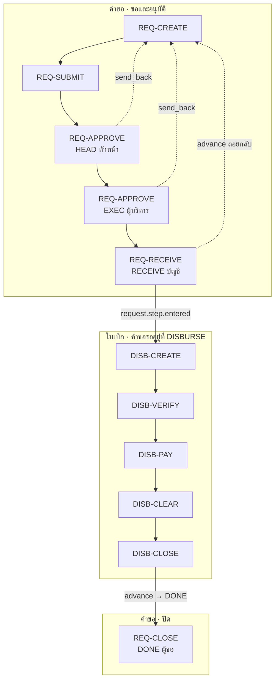

# FI05 เงินทดรองจ่าย = REQ-* + DISB-*

**FI05 = sub-flow ของคำขอ (ขอ → หัวหน้าอนุมัติ → ผู้บริหารอนุมัติ → บัญชีรับเรื่อง) + sub-flow ของใบเบิก (ตรวจ → จ่าย → เคลียร์ → ปิด) + ผู้ขอปิดคำขอ**

ใบเบิกชนิด `ADVANCE` คือรับเงินไปก่อน แล้วเคลียร์ด้วยใบเสร็จทีหลัง
ที่มา: `request-management-backend/libs/prisma/disbursement-flows.ts` (`disbursementFlow('ADVANCE', …)`) · `seed-petty-cash-type.ts` · [`docs/disbursement.md`](../../../request-management-backend/docs/disbursement.md) · ภาพ `source/request type docs/expense/advance/Flow_Advance.png`, 1–7, 4b

## ลำดับการประกอบ

| # | ขั้นของคำขอ (`code`) | `scope_status` | sub-flow | ใครทำ | ภาพต้นทาง |
|---|---|---|---|---|---|
| 1 | `REQUEST` ขอเบิกเงินทดรอง | `draft` | [REQ-IDENTIFY](../sub/request.md#req-identify) → [REQ-CREATE](../sub/request.md#req-create) → [REQ-SUBMIT](../sub/request.md#req-submit) | ผู้ขอ | 1 สร้างรายการ |
| 2 | `HEAD` หัวหน้างานอนุมัติ | `pending_approval` | [REQ-APPROVE](../sub/request.md#req-approve) (`supervisor up:1`) | หัวหน้าตามสายของผู้ขอ | 2 รออนุมัติหัวหน้างาน |
| 3 | `EXEC` ผู้บริหารอนุมัติ | `pending_approval` | [REQ-APPROVE](../sub/request.md#req-approve) (`org` = หน่วย FAC ตาม `financeUnitId`) | ผู้บริหาร / หน่วยการเงิน | 4b ผู้บริหารอนุมัติผ่าน LINE |
| 4 | `RECEIVE` บัญชีรับเรื่อง | `submitted` | [REQ-RECEIVE](../sub/request.md#req-receive) | ผู้รับที่ผู้ขอเลือก | 3 อนุมัติแล้ว |
| 5 | `DISBURSE` ดำเนินการเบิก | `in_progress` | [DISB-CREATE](../sub/disbursement.md#disb-create) → [DISB-VERIFY](../sub/disbursement.md#disb-verify) → [DISB-PAY](../sub/disbursement.md#disb-pay) → [DISB-CLEAR](../sub/disbursement.md#disb-clear) → [DISB-CLOSE](../sub/disbursement.md#disb-close) | ระบบ · บัญชี · ผู้ขอ (เคลียร์) | 4 บัญชีตรวจสอบ · 5 รับเงินทดรอง · 6 เคลียร์ค่าใช้จ่าย · 7 ปิดรายการ |
| 6 | `DONE` ปิดรายการ | `approved` | [REQ-CLOSE](../sub/request.md#req-close) (`advance END`) | ผู้ขอ | 7 ปิดรายการ |

ใช้ได้ทุกขั้น: [REQ-VIEW](../sub/request.md#req-view) · [REQ-SEARCH](../sub/request.md#req-search) · [REQ-COMMENT](../sub/request.md#req-comment) · [REQ-NOTIFY](../sub/request.md#req-notify) · [DISB-VIEW](../sub/disbursement.md#disb-view) · [DISB-FILE](../sub/disbursement.md#disb-file)

## ทางออกนอกเส้นหลัก

| sub-flow | ทำได้ที่ | ผล | ห้ามเมื่อ |
|---|---|---|---|
| [REQ-APPROVE](../sub/request.md#req-approve) `send_back` | `HEAD`, `EXEC` | กลับ `REQUEST` (`return_to_step`) | — |
| [REQ-APPROVE](../sub/request.md#req-approve) `reject` | `HEAD`, `EXEC` | `rejected` จบ | — |
| [REQ-RETURN](../sub/request.md#req-return) (`advance` ถอยกลับ) | `RECEIVE` | กลับ `REQUEST` | — |
| [REQ-CANCEL](../sub/request.md#req-cancel) | ทุกขั้นก่อนจบ | `cancelled` + ใบเบิก `CANCELLED` ([DISB-CANCEL](../sub/disbursement.md#disb-cancel)) | เงินออกแล้ว (`PARTIALLY_PAID` / `PAID` / `CLEARING` / `CLOSED`) |
| [DISB-PAY](../sub/disbursement.md#disb-pay) void | `DISBURSE` | ยกเลิกงวดจ่าย | ผู้จ่ายงวดนั้นเอง · legacy |
| [DISB-CLEAR](../sub/disbursement.md#disb-clear) ตีกลับ | `DISBURSE` (ใบเบิก `CLEARING`) | ใบเบิกกลับ `PAID` ให้ผู้ขอส่งเคลียร์ใหม่ | — |

## ใครทำอะไรในวงจร

| คน | sub-flow |
|---|---|
| ผู้ขอ | REQ-CREATE · REQ-SUBMIT · DISB-CLEAR (ส่งเคลียร์) · DISB-FILE (`RECEIPT`, `REFUND_PROOF`) · REQ-CLOSE · REQ-CANCEL |
| หัวหน้า | REQ-APPROVE ที่ `HEAD` · REQ-CANCEL (ในฐานะหัวหน้าของผู้ขอ) |
| ผู้บริหาร / หน่วยการเงิน | REQ-APPROVE ที่ `EXEC` |
| บัญชี | REQ-RECEIVE · DISB-VERIFY · DISB-PAY · DISB-CLEAR (ตีกลับ) · DISB-CLOSE · DISB-FILE (`PAYMENT_SLIP`) |
| ระบบ | DISB-CREATE · DISB-CANCEL · REQ-NOTIFY |

## ฟอร์มขั้น `REQUEST`

| ฟิลด์ | บังคับ | `x-bind` → ใบเบิก |
|---|---|---|
| `requester_department` | ✓ | — |
| `cost_center` | ✓ (ค่าจาก master `cost_centers`) | `cost_center` |
| `payee` | ✓ | `payee` |
| `needed_by` | ✓ | `needed_by` |
| `clear_by` | ✓ | `clear_by` (`requiredBindings('ADVANCE')`) |
| `purpose` | ✓ | `purpose` |
| `remark` | — | — |
| `so_no` · `so_subject` · `ticket_no` · `project_code` | — | ฟิลด์ชื่อเดียวกัน |
| `expense_items[]` (≤ 20 แถว) | ✓ | `lines` |
| `.description` · `.cost_center` · `.amount` | ✓ ทุกแถว | `lines.*` |
| `.note` | — | `lines.note` |

ฟอร์มตรวจของบัญชี ([DISB-VERIFY](../sub/disbursement.md#disb-verify)): `checked_cost_center`, `checked_documents`, `checked_authority`, `note` บังคับครบ

## ต่างจาก FI06

| เรื่อง | FI05 | [FI06](FI06.md) |
|---|---|---|
| ขั้นอนุมัติ | `HEAD` → `EXEC` | `HEAD` เท่านั้น |
| เงิน | รับก่อน แล้วเคลียร์ทีหลัง | ใช้เงินไปแล้ว ใบเสร็จอยู่ในฟอร์มตั้งแต่ตอนยื่น |
| DISB-CLEAR | มี | ไม่มี |
| DISB-CLOSE เริ่มจาก | `CLEARING` + คิดส่วนต่าง | `PAID` |
| แถวรายการ | `cost_center` บังคับ | `receipt_date` บังคับ, `cost_center` ไม่บังคับ |

## `PROPOSED` ในวงจรนี้

- Form Card ในแชท และ AI ตรวจฟอร์มก่อนยื่น
- การ์ดอนุมัติ LINE ที่ `HEAD` / `EXEC` (ภาพ 4, 4b) · webhook มีแล้ว แต่ workflow ที่รับ webhook แล้วส่งการ์ดยังไม่มี
- AI อ่านใบเสร็จตอนเคลียร์ · แนบไฟล์ผ่าน Open API
- เตือนเมื่อใกล้หรือเลย `clear_by`
- ผู้อนุมัติที่ `EXEC` = หน่วย FAC เป็นข้อเสนอ ภาพ 4b ระบุแค่ CFO แก้ได้ใน flow builder

## สถานะการใช้งาน

flow v3 อยู่ในโค้ดแล้ว คำขอที่สร้างไว้ก่อนหน้ายังเดินบน flow legacy (`REQUEST → HEAD → RECEIVE → VERIFY → EXEC → PAY → CLEAR → DONE` ใบเบิกเกิดตอนยื่น) จนจบ ([disbursement.md §2](../../../request-management-backend/docs/disbursement.md))
