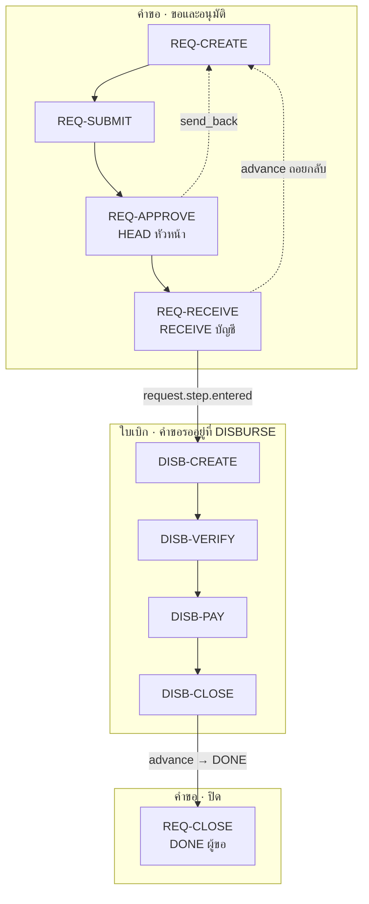

# FI06 เงินสดย่อย = REQ-* + DISB-* (ไม่มีเคลียร์)

**FI06 = sub-flow ของคำขอ (ขอ → หัวหน้าอนุมัติ → บัญชีรับเรื่อง) + sub-flow ของใบเบิก (ตรวจ → จ่าย → ปิด) + ผู้ขอปิดคำขอ**

ใบเบิกชนิด `PETTY_CASH` คือใช้เงินไปก่อน แล้วเบิกทีหลัง ใบเสร็จอยู่ในฟอร์มตั้งแต่ตอนยื่น จึงไม่มีขั้นเคลียร์ (ผู้ใช้กำหนด 9 ต.ค. 2569)
ที่มา: `request-management-backend/libs/prisma/disbursement-flows.ts` (`disbursementFlow('PETTY_CASH', …)`) · `seed-petty-cash-claim-type.ts` · [`docs/disbursement.md`](../../../request-management-backend/docs/disbursement.md)

> ภาพ `source/request type docs/expense/Petty Cash/LINE_NOTE_261008_1–5.jpg` **ไม่ใช้เป็นแหล่งอ้างอิง** ผู้ใช้แจ้งเมื่อ 9 ต.ค. 2569 ว่าภาพผิด (มีขั้นเคลียร์และขั้นจ่ายคืน ซึ่ง FI06 ไม่มี)

## ลำดับการประกอบ

| # | ขั้นของคำขอ (`code`) | `scope_status` | sub-flow | ใครทำ |
|---|---|---|---|---|
| 1 | `REQUEST` ขอเบิกเงินสดย่อย | `draft` | [REQ-IDENTIFY](../sub/request.md#req-identify) → [REQ-CREATE](../sub/request.md#req-create) → [REQ-SUBMIT](../sub/request.md#req-submit) | ผู้ขอ |
| 2 | `HEAD` หัวหน้างานอนุมัติ | `pending_approval` | [REQ-APPROVE](../sub/request.md#req-approve) (`supervisor up:1`) | หัวหน้าตามสายของผู้ขอ |
| 3 | `RECEIVE` บัญชีรับเรื่อง | `submitted` | [REQ-RECEIVE](../sub/request.md#req-receive) | ผู้รับที่ผู้ขอเลือก |
| 4 | `DISBURSE` ดำเนินการเบิก | `in_progress` | [DISB-CREATE](../sub/disbursement.md#disb-create) → [DISB-VERIFY](../sub/disbursement.md#disb-verify) → [DISB-PAY](../sub/disbursement.md#disb-pay) → [DISB-CLOSE](../sub/disbursement.md#disb-close) | ระบบ · บัญชี |
| 5 | `DONE` ปิดรายการ | `approved` | [REQ-CLOSE](../sub/request.md#req-close) (`advance END`) | ผู้ขอ |

ใช้ได้ทุกขั้น: [REQ-VIEW](../sub/request.md#req-view) · [REQ-SEARCH](../sub/request.md#req-search) · [REQ-COMMENT](../sub/request.md#req-comment) · [REQ-NOTIFY](../sub/request.md#req-notify) · [DISB-VIEW](../sub/disbursement.md#disb-view) · [DISB-FILE](../sub/disbursement.md#disb-file)

## ทางออกนอกเส้นหลัก

| sub-flow | ทำได้ที่ | ผล | ห้ามเมื่อ |
|---|---|---|---|
| [REQ-APPROVE](../sub/request.md#req-approve) `send_back` / `reject` | `HEAD` | กลับ `REQUEST` / `rejected` | — |
| [REQ-RETURN](../sub/request.md#req-return) (`advance` ถอยกลับ) | `RECEIVE` | กลับ `REQUEST` | — |
| [REQ-CANCEL](../sub/request.md#req-cancel) | ทุกขั้นก่อนจบ | `cancelled` + ใบเบิก `CANCELLED` | เงินออกแล้ว (`PARTIALLY_PAID` / `PAID` / `CLOSED`) |
| [DISB-PAY](../sub/disbursement.md#disb-pay) void | `DISBURSE` | ยกเลิกงวดจ่าย | ผู้จ่ายงวดนั้นเอง |

## ใครทำอะไรในวงจร

| คน | sub-flow |
|---|---|
| ผู้ขอ | REQ-CREATE · REQ-SUBMIT · DISB-FILE (`RECEIPT`) · REQ-CLOSE · REQ-CANCEL |
| หัวหน้า | REQ-APPROVE ที่ `HEAD` |
| บัญชี | REQ-RECEIVE · DISB-VERIFY · DISB-PAY · DISB-CLOSE · DISB-FILE (`PAYMENT_SLIP`) |
| ระบบ | DISB-CREATE · DISB-CANCEL · REQ-NOTIFY |

## ฟอร์มขั้น `REQUEST`

| ฟิลด์ | บังคับ | `x-bind` → ใบเบิก |
|---|---|---|
| `cost_center` | ✓ (ค่าจาก master `cost_centers`) | `cost_center` |
| `payee` | ✓ | `payee` |
| `purpose` | ✓ | `purpose` |
| `remark` | — | — |
| `so_no` · `so_subject` · `ticket_no` · `project_code` | — | ฟิลด์ชื่อเดียวกัน |
| `expense_items[]` (≤ 20 แถว) | ✓ | `lines` |
| `.receipt_date` · `.description` · `.amount` | ✓ ทุกแถว | `lines.*` |
| `.cost_center` · `.note` | — | `lines.*` |

ฟอร์มตรวจของบัญชีเหมือน FI05: `checked_cost_center`, `checked_documents`, `checked_authority`, `note`

## ต่างจาก FI05

ดูตารางใน [FI05.md](FI05.md#ต่างจาก-fi06)
ข้อที่สำคัญคือ FI06 ไม่มีขั้น `EXEC` และไม่มี DISB-CLEAR และ `pay` จนครบยอดก็ไม่ปิดใบเบิกให้เอง บัญชีต้องกด DISB-CLOSE เพื่อเลื่อนคำขอไป `DONE`

## `PROPOSED` ในวงจรนี้

- Form Card ในแชท · AI อ่านใบเสร็จแล้วเติม `expense_items` ตอนยื่น
- การ์ดอนุมัติ LINE ที่ `HEAD`
- แนบไฟล์ผ่าน Open API
