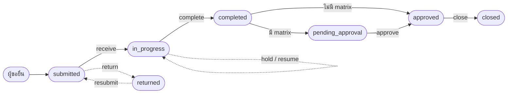

# GENERAL คำขอทั่วไป = REQ-*

**คำขอทั่วไป = ผู้ขอยื่น → ผู้รับรับเรื่อง → ทำงาน → ส่งงาน → ผู้ขอปิด**

เป็นวงจรของ type ที่**ไม่มี flow** ซึ่งเป็น type ส่วนใหญ่ในระบบ เช่น `BS-01` ขอเปิด SO และ `PS01` ขอ Pre-Sales
สถานะเดินตาม `REQUEST_TRANSITIONS` ใน `services/core-service/src/requests/request-state-machine.ts` ไม่มีขั้น (step) และไม่มีโมดูลปลายทาง
ตัวอย่าง curl ที่ยิงได้จริงอยู่ที่ [`docs/ex/use-case-curl.md` ข้อ 1](../../ex/use-case-curl.md) (BS-01) และฉบับ Keycloak อยู่ที่ [`docs/ex/uat-request-open-api-keycloak/`](../../ex/uat-request-open-api-keycloak/README.md)

## วงจร

| # | ขั้น | สถานะ | ใครทำ | API (Open API · `actions/<x>` = `POST request/requests/:ref/actions/<x>`) |
|---|---|---|---|---|
| 1 | ยื่นคำขอ | → `submitted` | ผู้ขอ | `POST request/requests` สร้างและยื่นใน call เดียว · [REQ-CREATE](../sub/request.md#req-create) · [REQ-SUBMIT](../sub/request.md#req-submit) |
| 2 | รับเรื่อง | `submitted` → `in_progress` | ผู้รับที่ผู้ขอเลือก | `actions/receive` · [REQ-RECEIVE](../sub/request.md#req-receive) · SLA เริ่มเดินที่นี่ |
| 3 | ทำงาน | `in_progress` | ผู้รับ / คนที่ได้รับมอบหมาย | `actions/assign` · `actions/comment` · `actions/hold` / `resume` · [REQ-ASSIGN](../sub/request.md#req-assign) · [REQ-HOLD](../sub/request.md#req-hold) · [REQ-COMMENT](../sub/request.md#req-comment) |
| 4 | ส่งงาน | `in_progress` → `completed` → `approved` | ผู้ทำ | `actions/complete {receiver_form_data}` ถ้า type ไม่มี matrix ระบบจะพาไป `approved` เอง ถ้ามี matrix จะรอ [REQ-APPROVE](../sub/request.md#req-approve) |
| 5 | ผู้ขอปิด | `approved` → `closed` | ผู้ขอเท่านั้น | `actions/close` · [REQ-CLOSE](../sub/request.md#req-close) |

ทางออกนอกเส้นหลัก
- **ส่งกลับให้แก้**: `actions/return {reason_code}` ได้ `returned` จากนั้นผู้ขอยื่นใหม่ด้วย `actions/resubmit` ([REQ-RETURN](../sub/request.md#req-return))
- **ยกเลิก**: `actions/cancel {reason}` ทำได้ทุกสถานะที่ยังไม่จบ ยกเว้น `completed` ([REQ-CANCEL](../sub/request.md#req-cancel))
- **ใบลูก**: `POST request/requests` พร้อม `parent_request_id` (uuid ของใบแม่) ดูทั้งสายด้วย `GET …/:ref/tree` ถ้าใบลูกยังไม่จบ ใบแม่จะปิดไม่ได้ ([REQ-CHILD](../sub/request.md#req-child))

## ค้นหาและเปิดดู

ทุกคนในวงจรหางานของตัวเองด้วยสองคำสั่งนี้

1. **ค้นหา** `GET request/requests?view=incoming` (งานที่ส่งมาให้ฉัน) หรือ `view=created` (ที่ฉันยื่น) ทุกแถวมี `available_actions` บอกว่าคนที่ถามกดปุ่มไหนได้ ([REQ-SEARCH](../sub/request.md#req-search))
2. **เปิดดู** `GET request/requests/:ref` และ `GET …/:ref/actions` ใช้ก่อนกดปุ่ม เพราะ `actions` บอกช่องที่ปุ่มนั้นต้องกรอกด้วย ([REQ-VIEW](../sub/request.md#req-view))

ปุ่มมาจากระบบทั้งสองทาง ไม่ต้องเดาจากสถานะ

## ถ้า type มี flow

type ที่ publish flow v2 ไม่ใช้วงจรนี้ ไม่มี `complete` / `close` / `return` / `resubmit` และเลื่อนขั้นด้วย `advance` แทน ดูได้ที่ไฟล์ของ type นั้นใน [`types/`](./)
