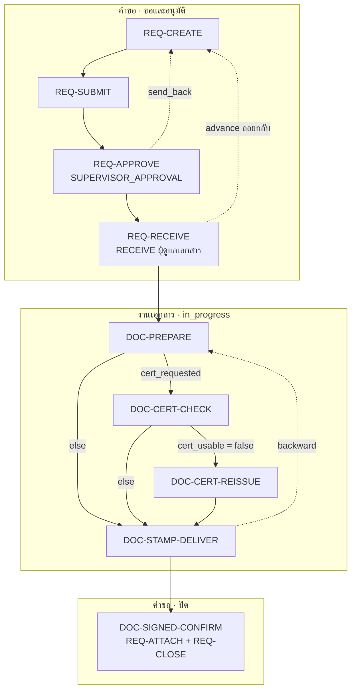

# SOP_DOCREQ ขอใช้เอกสารสำคัญ = REQ-* + DOC-*

**SOP_DOCREQ = sub-flow ของคำขอ (ขอ → หัวหน้าอนุมัติ → ผู้ดูแลเอกสารรับเรื่อง) + sub-flow ของงานเอกสาร (ค้นไฟล์ → [ตรวจ / คัดหนังสือรับรอง] → คาดข้อความและส่ง) + ผู้ขอแนบเอกสารที่ลงนามแล้วและปิดงาน**

ประเภทนี้ไม่มีโมดูลปลายทาง งานเอกสารทั้งหมดเป็นขั้นของคำขอเอง (ต่างจาก FI05/FI06 ที่งานเงินอยู่บนใบเบิก)
ที่มา: `request-management-backend/libs/prisma/sop-docreq-flow.ts` · `seed-sop-docreq-type.ts` · `source/request type docs/SOP-BSD-DOCREQ/SOP-BSD-DOCREQ.docx`
ตั้งค่า: แผนกที่ขอได้ `FAC`, `LEG`, `PCD` · SLA 24 ชม. (`H8X5`) · ขั้น `CERT_REISSUE` 8 ชม.

## ลำดับการประกอบ

| # | ขั้นของคำขอ (`code`) | `scope_status` | sub-flow | ใครทำ | SOP |
|---|---|---|---|---|---|
| 1 | `REQUEST` ยื่นคำขอ | `draft` | [REQ-IDENTIFY](../sub/request.md#req-identify) → [REQ-CREATE](../sub/request.md#req-create) → [REQ-SUBMIT](../sub/request.md#req-submit) | ผู้ขอ | ข้อ 3 |
| 2 | `SUPERVISOR_APPROVAL` หัวหน้างานอนุมัติ | `pending_approval` | [REQ-APPROVE](../sub/request.md#req-approve) (`supervisor up:1`) | หัวหน้าตามสายของผู้ขอ | ข้อ 3 |
| 3 | `RECEIVE` ผู้ดูแลเอกสารตรวจวัตถุประสงค์ | `submitted` | [REQ-RECEIVE](../sub/request.md#req-receive) · หรือ [REQ-RETURN](../sub/request.md#req-return) เมื่อวัตถุประสงค์ไม่สมเหตุสมผล | ผู้ดูแลเอกสาร | ข้อ 4 |
| 4 | `PREPARE` ค้นไฟล์เอกสารล่าสุด | `in_progress` | [DOC-PREPARE](../sub/docreq.md#doc-prepare) | ผู้ดูแลเอกสาร (+ AGENT 1) | ข้อ 4–5 |
| 5 | `CERT_CHECK` ตรวจวันที่หนังสือรับรอง | `in_progress` | [DOC-CERT-CHECK](../sub/docreq.md#doc-cert-check) | ผู้ดูแลเอกสาร (+ AGENT 2) | ข้อ 5.2 |
| 6 | `CERT_REISSUE` คัดหนังสือรับรองใหม่ | `in_progress` | [DOC-CERT-REISSUE](../sub/docreq.md#doc-cert-reissue) | ผู้ดูแลเอกสาร | ข้อ 5.2 |
| 7 | `STAMP_DELIVER` คาดข้อความ ปริ้น และส่งเอกสาร | `in_progress` | [DOC-STAMP-DELIVER](../sub/docreq.md#doc-stamp-deliver) | ผู้ดูแลเอกสาร (+ AGENT 1) | ข้อ 5.1 |
| 8 | `SIGNED_CONFIRM` แนบเอกสารที่ลงนามแล้ว ยืนยันจบงาน | `approved` | [DOC-SIGNED-CONFIRM](../sub/docreq.md#doc-signed-confirm) = [REQ-ATTACH](../sub/request.md#req-attach) + [REQ-CLOSE](../sub/request.md#req-close) | ผู้ขอ | ข้อ 6 |

ขั้น 5 และ 6 ทำเฉพาะเมื่อทางแยกพาไป · ใช้ได้ทุกขั้น: [REQ-VIEW](../sub/request.md#req-view) · [REQ-SEARCH](../sub/request.md#req-search) · [REQ-COMMENT](../sub/request.md#req-comment) · [REQ-ASSIGN](../sub/request.md#req-assign) · [REQ-NOTIFY](../sub/request.md#req-notify)
ทุกขั้นที่ 4–7 ใช้ [REQ-STEP-FORM](../sub/request.md#req-step-form) แล้วตามด้วย [REQ-ADVANCE](../sub/request.md#req-advance)

## ทางออกนอกเส้นหลัก

| sub-flow | ทำได้ที่ | ผล |
|---|---|---|
| [REQ-APPROVE](../sub/request.md#req-approve) `send_back` / `reject` | `SUPERVISOR_APPROVAL` | กลับ `REQUEST` / `rejected` |
| [REQ-RETURN](../sub/request.md#req-return) (`advance` ถอยกลับ) | `RECEIVE` | กลับ `REQUEST` · รหัสเหตุผล `PURPOSE_UNCLEAR` / `INFO_INCOMPLETE` / `DOC_NOT_ALLOWED` / `OTHER` |
| [REQ-ADVANCE](../sub/request.md#req-advance) ถอยกลับ | `STAMP_DELIVER` | กลับ `PREPARE` |
| [REQ-HOLD](../sub/request.md#req-hold) | ขั้น `in_progress` | `on_hold` (SLA หยุด) |
| [REQ-CANCEL](../sub/request.md#req-cancel) | ทุกขั้นก่อนจบ | `cancelled` |

## ฟอร์มขั้น `REQUEST` (SOP ข้อ 3)

| ฟิลด์ | บังคับ | หมายเหตุ |
|---|---|---|
| `documents[]` · `.document` · `.copies` | ✓ | เลือกจาก 8 รายการใน `SOP_DOCUMENTS` · จำนวนชุดตั้งแต่ 1 |
| `includes_company_cert` | ✓ | มีหนังสือรับรองบริษัทในรายการที่ขอ |
| `cert_valid_days` | — | อายุหนังสือรับรองที่ต้องการ นับจากวันที่เอกสาร (ไม่เกิน 30 วัน) |
| `counterparty_type` | ✓ | `Vendor` / `Customer` / `Other` |
| `counterparty_name` | ✓ | — |
| `purpose` | ✓ | ผู้ดูแลเอกสารใช้ตรวจที่ขั้น `RECEIVE` |
| `watermark_text` | ✓ | ข้อความที่จะคาดบนสำเนา (DOC-STAMP-DELIVER) |
| `needed_by` | ✓ | ใช้ตรวจใน DOC-CERT-CHECK |
| `note` | — | — |

## `PROPOSED` ในวงจรนี้

- Form Card ในแชท · AI ตรวจฟอร์มก่อนยื่น · การ์ดอนุมัติ LINE ที่ `SUPERVISOR_APPROVAL`
- AGENT 1 (ค้นไฟล์ และคาดข้อความ) · AGENT 2 (ตรวจวันที่) · Folder เอกสารบริษัทและสิทธิ์ที่ AI ใช้เข้าถึง
- บันทึก step form และแนบ `SIGNED_DOCUMENT` ผ่าน Open API ตอนนี้แชทอย่างเดียวจึงปิดคำขอประเภทนี้ไม่ได้
- ทะเบียนเอกสารบริษัท (SOP ข้อ 1–2) ดู [DOC-REGISTER](../sub/docreq.md#doc-register)
